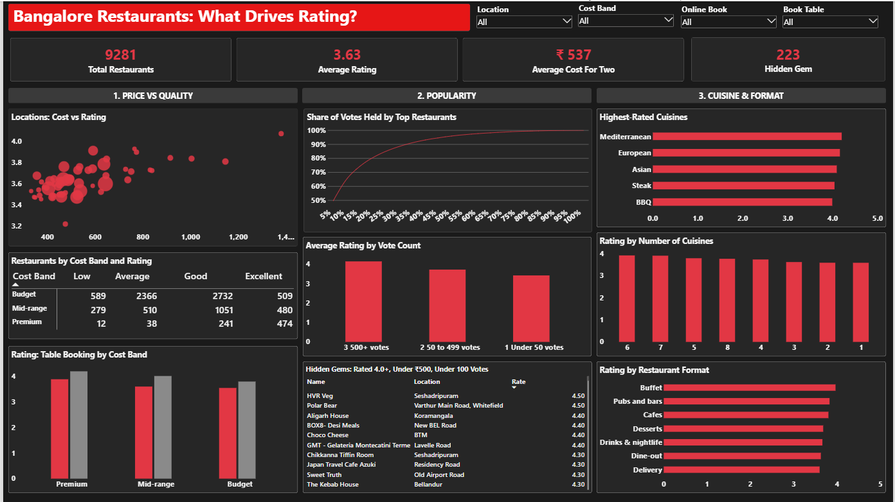

# Zomato Bangalore Restaurant Analysis

An end-to-end analysis of Bangalore restaurants from the Zomato dataset, using **Python**, **MySQL** and **Power BI**. The project cleans the raw data, answers 15 business questions in SQL, and presents the results in a one-page interactive dashboard.

## Key findings

- **9,281 unique restaurants** remain after cleaning, from 51,717 raw rows.
- **Whitefield has the most restaurants (614)**, followed by BTM (517) and HSR (514).
- **Premium restaurants rate higher.** Premium places average 4.10, Mid-range 3.67 and Budget 3.55.
- **Table booking goes with higher ratings in every cost band**, adding about 0.2 to 0.4 rating points. Only about 10% of restaurants offer it.
- **Online ordering is common** (about 61% of restaurants), but its average rating (3.65) is close to restaurants without it (3.59).
- **A few restaurants hold most of the votes.** The top 10% of restaurants by votes hold about 65% of all votes.
- **Popular places rate higher.** Restaurants with 500+ votes average 4.15, against 3.42 for those with under 50 votes.
- **223 hidden gems** are rated 4.0 or higher, cost ₹500 or less for two, and have fewer than 100 votes.
- **Mediterranean (4.20), European (4.16) and Asian (4.09)** are the highest-rated cuisines, each with at least 50 restaurants.
- **Restaurants serving more cuisines rate slightly higher**, from about 3.59 for one cuisine to about 3.9 for six or seven.
- **Lavelle Road has the highest average rating (4.07)** among locations with at least 20 restaurants, and the highest average cost for two (about ₹1,380).

## Repository contents

| File | Description |
|---|---|
| `zomato-restaurants-analysis.ipynb` | Python notebook: data cleaning, feature engineering and loading into MySQL |
| `zomato_analysis.sql` | 15 SQL queries answering the business questions |
| `zomato_cleaned.csv` | Cleaned dataset (9,281 rows), used for the MySQL table and the Power BI dashboard |
| `zomato_cuisine_summary.csv` | Cuisine-level summary (cuisines with at least 50 restaurants) |
| `Zomato_Dashboard.pbix` | Power BI dashboard |
| `Zomato_Dashboard.png` | Screenshot of the dashboard |
| `Zomato_Analysis.pptx` | Presentation slides summarising the findings |
| `Zomato_Summary.docx` | Written project summary |

## Dataset

The raw data is the Zomato Bangalore Restaurants dataset from Kaggle, with 51,717 rows and 17 columns. Each row is a restaurant listing, and the same restaurant can appear more than once.

## Workflow

### 1. Cleaning (Python, Pandas)

- Dropped columns not needed for the analysis: `url`, `phone`, `menu_item`, `reviews_list` and `dish_liked`
- Renamed columns to `snake_case`, and renamed `approx_cost(for two people)` to `cost_for_two`
- Removed duplicate restaurants using `name` and `address`. This reduced the data to 12,499 unique restaurants.
- Converted `rate` from text such as "4.1/5" to a number, and treated "NEW" and "-" as missing
- Removed commas from the cost column and converted it to a number
- Removed restaurants with no rating, cost, location or cuisine, leaving 9,281 rows
- Added `cost_band` (Budget up to ₹500, Mid-range ₹500 to ₹1,000, Premium above ₹1,000), `rating_band`, and `cuisine_count`

### 2. Loading into MySQL

The cleaned DataFrame is written to a `restaurants` table in a `zomato_analysis` database, using SQLAlchemy and PyMySQL. The database password is entered at run time, not stored in the notebook.

### 3. SQL analysis

The 15 queries in `zomato_analysis.sql` use `GROUP BY`, `HAVING`, `CASE WHEN`, `FIELD` for custom ordering, and the `ROW_NUMBER()` window function. They cover:

1. Most common locations
2. Restaurant types, with rating and cost
3. Online ordering and rating
4. Table booking and rating or cost
5. Locations with the highest rating
6. Cost bands, count and rating
7. Top 3 most-voted restaurants per location
8. Cheap, highly rated restaurants
9. Cuisine count and rating
10. Online ordering share by rating band
11. Most expensive locations
12. Restaurant types with the most votes
13. Online ordering and cost
14. Rating band and cost
15. Locations with the highest share of Premium restaurants

### 4. Power BI dashboard

The dashboard connects to MySQL in Import mode and has three sections:

- **Price vs Quality:** cost against rating by location, the cost band and rating matrix, and rating by table booking
- **Popularity:** the share of votes held by top restaurants, rating by vote count, and the hidden gems table
- **Cuisine & Format:** the highest-rated cuisines, rating by number of cuisines, and rating by restaurant format

Four cards at the top show total restaurants, average rating, average cost for two and hidden gems. Slicers for location, cost band, online ordering and table booking filter every visual.

## Data notes

Three issues were handled while preparing the data:

- **37 rows had no `rest_type`.** They were set to "Unknown" so they stay in the data.
- **One row had no `cost_band`.** It is a ₹6,000 restaurant, so it was set to "Premium". The cost band cut-off was first set too low, which left this row without a band.
- **One address contained quotation marks** ("Phulke Ghar Me"). When the file was imported into MySQL, the quotation marks ended the text field early and that restaurant was dropped, leaving 9,280 rows. The quotation marks were replaced with single quotes, and the import then loaded all 9,281 rows.

## How to run

1. Install the requirements: `pip install pandas sqlalchemy pymysql`
2. Create a MySQL database named `zomato_analysis`.
3. Load the data into a `restaurants` table, using either option:
   - **Notebook:** open `zomato-restaurants-analysis.ipynb` and run the cells. Set the password in the `MYSQL_PASSWORD` environment variable, so it isn't stored in the notebook.
   - **MySQL Workbench:** right-click the schema, choose **Table Data Import Wizard** and load `zomato_cleaned.csv`. Check that the row count is 9,281.
4. Run `zomato_analysis.sql` in MySQL Workbench or the MySQL command line.
5. Open `Zomato_Dashboard.pbix` in Power BI Desktop. Under **Data source settings**, update the MySQL login if yours differs.

## Limitations

- **Cost for two is an estimate** from the listing, not the actual bill.
- **Ratings and votes are user-generated**, so popular places may be over-represented.
- **Relationships are correlations, not causes.** For example, table booking goes with higher ratings, but the data does not show that booking causes them. The correlation between rating and cost is about 0.33, which is modest.
- **The data is a snapshot** and does not show how ratings changed over time.

## Tools

Python (Pandas, SQLAlchemy, PyMySQL) · MySQL · Power BI
